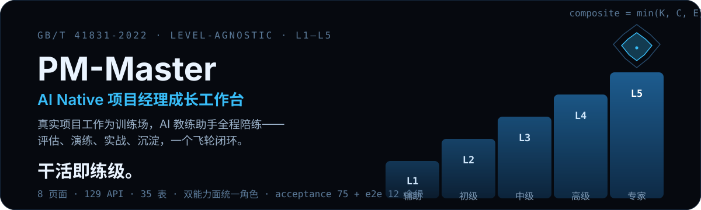
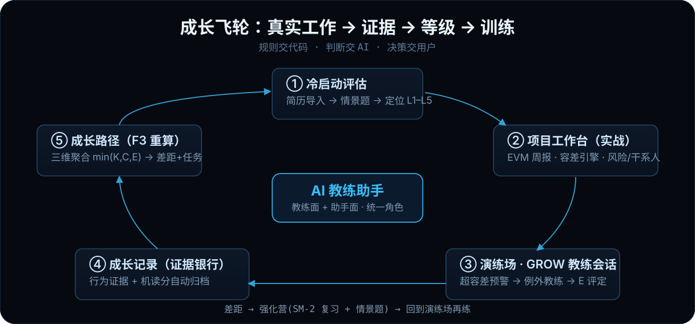

<p align="center">
  
</p>

# PM-Master

**一个把「日常工作」变成「能力证据」的项目经理成长工作台。** 单用户、本地运行、等级无关（L1-L5 全程），以 **GB/T 41831-2022《项目管理专业人员能力评价要求》** 为唯一评级坐标——任何等级相关内容零硬编码，全部从国标 YAML 派生。

- **AI 教练助手（统一角色）**：一个角色、两个能力面——教练面（GROW 演练·辅导）+ 助手面（一句话执行·问答），共享同一画像、同一份记忆、同一条上下文注入链，全站唯一对话入口（侧栏 + FAB + ⌘K）。
- **干活即练级**：周报、风险、会议纪要不只是工作产物——E 评定、机读分与行为证据自动归档进成长记录，月度三维聚合 `min(K, C, E)` 算出差距并生成训练任务。
- **规则交代码，判断交 AI，决策交用户**：GROW 推进、EVM、容差比对、SM-2 调度是纯代码；LLM 只做内容生成与判定，所有写操作双确认。

> 当前基线 **v0.1.0**（2026-10-13 定基）。完整设计与演进史见 [PRD.md](./PRD.md)，功能验收标准见 [docs/ACCEPTANCE-SPEC.md](./docs/ACCEPTANCE-SPEC.md)。

## 成长飞轮

<p align="center">
  
</p>

八个页面各司其职：

| 页面 | 职责 |
|---|---|
| **演练场** | GROW 场景演练（10+ 场景随等级解锁），会话结束 E 评定自动归档证据 |
| **项目工作台** | 真实项目：EVM 周报、容差引擎预警、风险二阶推演、干系人、会议行动项 |
| **风险评估** | 专项评估流，产物回链演练场「经验教训萃取」场景 |
| **成长记录** | 证据银行：教练归档 + 手动录入 + 经验硬指标进度（随档案等级换档） |
| **强化营** | SM-2 遗忘曲线复习卡 + 情景应用题（认知深度随目标等级） |
| **知识库** | ITTO 工具库四步教学（讲→示→练→用）+ M0-M3 掌握度矩阵 |
| **成长路径** | 雷达图（29 指标 / 17 领域）、三维合成分、差距 Top5、训练任务 |
| **设置** | 模型/人设/记忆/提示词库/技能注册表/巡检/飞书读写，热生效 |

## 快速启动

前置：**Node.js ≥ 22.5**（内置 `node:sqlite`，免编译原生模块）、macOS（密钥托管 Keychain）。

```bash
./pm.sh start      # 一键起 server(:8735) + web(:8736)，含依赖安装与健康等待
./pm.sh status     # 进程 / 健康 / 凭据 / 数据量总览
./pm.sh doctor     # 体检：Node / YAML / 源码语法 / 端口
./pm.sh backup     # 备份数据库（.backups/，保留 10 份）
```

打开 **http://localhost:8736** 即可使用；不配任何密钥时以 mock provider 全功能可跑（降级不断流）。

<details>
<summary>手动启动与密钥托管（Keychain / AES-256）</summary>

```bash
cd server
cp .env.example .env        # 填入 AGENT_PROVIDER / OPENAI_API_KEY 等
npm run secrets -- lock     # 加密入 Keychain 并删除明文；此后启动无需明文
npm install && npm run dev  # with-env.sh 自动解密注入（内存级，进程退出即删）

cd ../web && npm install && npm run dev
```

| 命令 | 作用 |
|---|---|
| `npm run secrets -- lock` | `.env` → AES-256 加密为 `.env.enc`（密钥存 Keychain，服务名 `pm-master`），删除明文 |
| `npm run secrets -- unlock` | 临时解密回 `.env`（编辑后记得重新 lock） |
| `npm run secrets -- status` | 查看明文 / 密文 / Keychain 三态 |

`.env`、`.env.enc`、`server/data/` 均已 gitignore，永不入库；日志与回复中禁止输出 key。换机器需在新机 Keychain 重建密钥（手动传 `.env` 后重新 lock）。

</details>

### `.env` 配置项

```ini
AGENT_PROVIDER=openai            # mock | openai（OpenAI 兼容）| pi
OPENAI_BASE_URL=...              # 如 https://token.sensenova.cn/v1
OPENAI_API_KEY=sk-...
OPENAI_MODEL=...                 # 强模型池：教练/周报/评定
OPENAI_MODEL_FAST=...            # 快模型池：出题/判分（RPM 宽松，429 分池退避）
OPENAI_MAX_TOKENS=6000           # 推理模型思考耗 token，预算放大
FEISHU_APP_ID=cli_...            # 可选：飞书云文档读写（不配则降级 .md 下载）
FEISHU_APP_SECRET=...
```

## 验证与验收

```bash
cd server
npm run test:acceptance   # 单元 + HTTP 边界：75 tests（74 pass / 1 skip）
npm run test:e2e          # 浏览器渲染回归（自起隔离 server+vite，本机 Chrome）：12/12
node --check <file>       # 提交前语法校验
```

评级口径装载验证：`curl -s localhost:8735/api/v2/standard/requirements/<lv>`。

## 架构

```
pm-master/
├── PRD.md                  # 产品需求文档（v0.1.0 基线，演进史在文末变更记录）
├── standard/               # 系统宪法：评级唯一依据（GB/T 41831 结构化 YAML）
│   ├── gbt41831.yaml       #   五级 × 17 领域深度矩阵 × 29 指标 × 经验硬指标
│   ├── pmp-prince2-map.yaml
│   └── indicator-training-map.yaml
├── docs/                   # ACCEPTANCE-SPEC（验收）/ MEMORY-ARCHITECTURE（记忆）
│   └── ...                 # / UI-DESIGN-SPEC（组件）/ 01-03（v6.0 规划系列）
├── server/                 # Fastify 4 + node:sqlite（35 表）
│   ├── src/index.mjs       #   31 行装配根
│   ├── src/routes/         #   24 个按域路由 + repo/×6（SQL 归仓）+ scheduler.mjs
│   ├── src/agent.mjs       #   LLM 适配层：统一角色 ROLE_LINE · mock/openai/pi · 双模型池
│   ├── src/coach.mjs       #   GROW 状态机（规则推进 + LLM 内容分离）
│   ├── src/workbench.mjs   #   EVM + 容差引擎（纯代码）
│   ├── src/drill.mjs       #   SM-2 + 情景题（深度随等级）
│   ├── src/growth.mjs      #   三维聚合 min(K,C,E) + 差距 + 任务
│   └── scripts/            #   secrets.sh / with-env.sh（Keychain 托管）
├── web/                    # Vite 5 + React 18（8 tab · hash 深链 · 全局 CSS 设计令牌双主题）
└── GB-T41831-2022_ocr_raw.txt   # 国标原文 OCR（结构化校对依据）
```

<details>
<summary>API 一览（:8735，域前缀 /api/v2/&lt;domain&gt;）</summary>

| 域 | 端点 |
|---|---|
| 标准 | `GET /api/v2/standard/:name` · `GET /api/v2/standard/requirements/:level?track=` · `POST /api/v2/standard/gap-analysis` |
| 档案 | `GET/PUT /api/v2/profile`（current_level 切换 = 全模块自适应） |
| 教练 | `GET /api/v2/coach/scenarios` · `POST /api/v2/coach/sessions` · `POST .../messages` · `POST .../control` · `POST .../close`（E 评定 + 归档） |
| 助手 | `POST /api/v2/assistant/parse`（NL→意图→计划）· `POST .../execute`（双确认）· `GET/DELETE .../messages` |
| 工作台 | `GET/POST /api/v2/projects` · `POST .../weekly` · `POST .../tolerance-check` · risks / stakeholders / meetings |
| 预警 | `GET /api/v2/projects/alerts` · `POST /api/v2/projects/alerts/:id/ack` |
| 成长记录 | `GET/POST /api/v2/records/evidence` · `GET/PUT /api/v2/records/experience-stats` |
| 强化营 | `GET /api/v2/drill/queue` · `POST /api/v2/drill/cards/:id/review` · `POST /api/v2/drill/scenario/:domain` |
| 成长路径 | `GET /api/v2/growth/scores\|history` · `POST /api/v2/growth/recalc` · `GET/POST /api/v2/drill/tasks` |
| 记忆 | `GET/POST /api/v2/settings/memories` · `POST /api/v2/memories/maintenance` · `GET /api/v2/settings/context-preview` |
| 集成 | `GET /api/v2/feishu/status` · `POST /api/v2/feishu/export-doc` · `POST /api/v2/feishu/delete` · `GET /api/v2/scheduler` · `POST /api/v2/scheduler/run/:job` |

探针 `/api/health` 保持稳定。飞书应用需开通 `docx:document`、`drive:permission`（删除另需 `drive:drive`）。

</details>

## 十分钟上手

1. **演练场** → 资源谈判 → 走 GROW（fast 模式 3 层 Why）→ 结束并归档（看 E 评定）
2. **工作台** → 生成周报（PV 420 / EV 398 / AC 458 触发 CPI 预警）→ 预警卡「进入例外教练」
3. **强化营** → 复习 2 张卡 + 做一道情景题（深度随目标级）
4. **成长路径** → F3 月度重算 → 看雷达 / 差距 / 自动生成任务 → 去成长记录更新经验现值
5. **侧栏教练**（⌘K）→ 输入「给当前项目登记风险：核心工程师离职」→ 计划卡确认执行

## 文档地图

| 文档 | 内容 |
|---|---|
| [PRD.md](./PRD.md) | 产品设计 + 决策日志（D1-D11）+ 完整变更记录 |
| [docs/ACCEPTANCE-SPEC.md](./docs/ACCEPTANCE-SPEC.md) | 统一角色功能验收标准（RC/CB/IX/FM/RS 五组） |
| [docs/MEMORY-ARCHITECTURE.md](./docs/MEMORY-ARCHITECTURE.md) | 记忆分层 / 复利闭环 / 画像蒸馏设计 |
| [docs/UI-DESIGN-SPEC.md](./docs/UI-DESIGN-SPEC.md) | 设计令牌 / 双主题 / 组件规范 / 响应式断点 |
| [AGENTS.md](./AGENTS.md) | AI 编码助手协作规则（硬约束 / 常用命令 / 已知坑） |
| [demo/index.html](./demo/index.html) | 高保真可交互原型（设计语言参考） |

## License

本项目基于 [Apache License 2.0](./LICENSE) 开源。

---

<p align="center">
  <a href="https://github.com/oil-oil/beautify-github-readme"></a>
</p>
